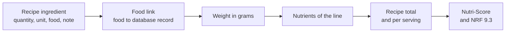
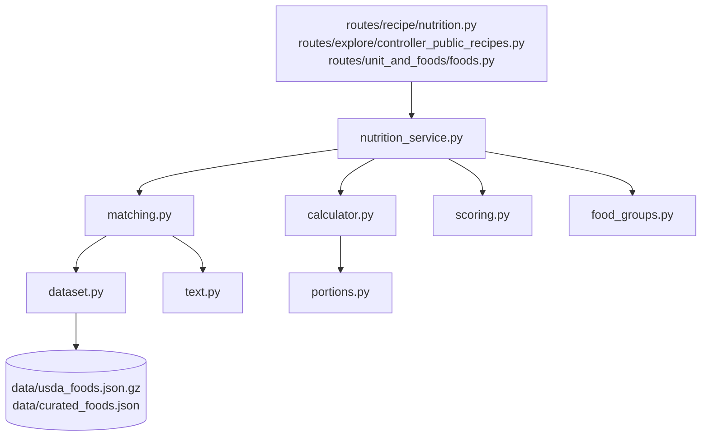
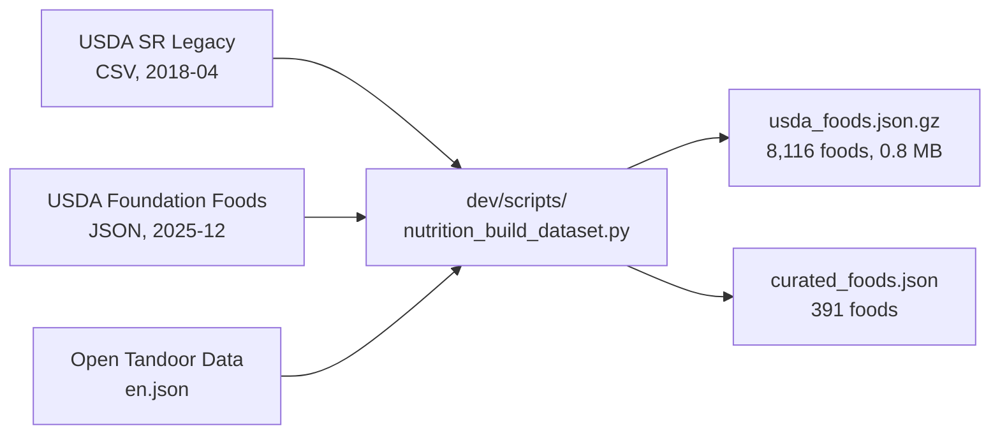
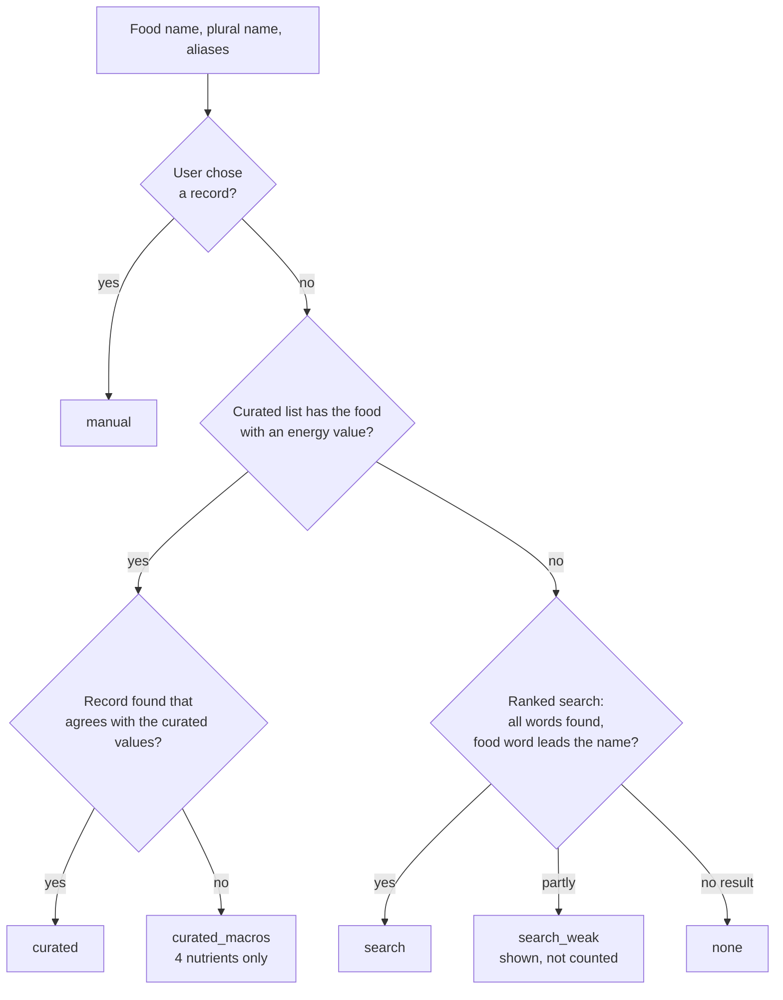
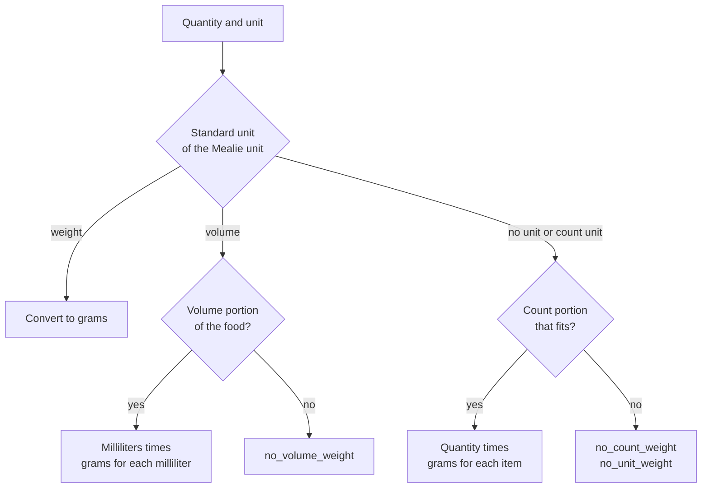
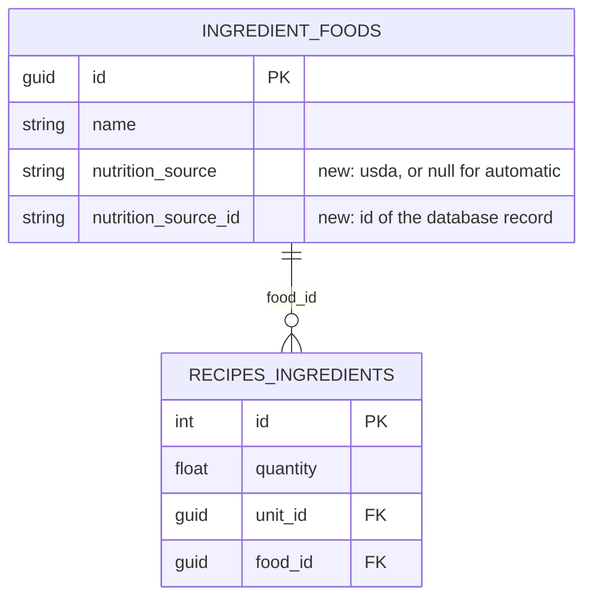
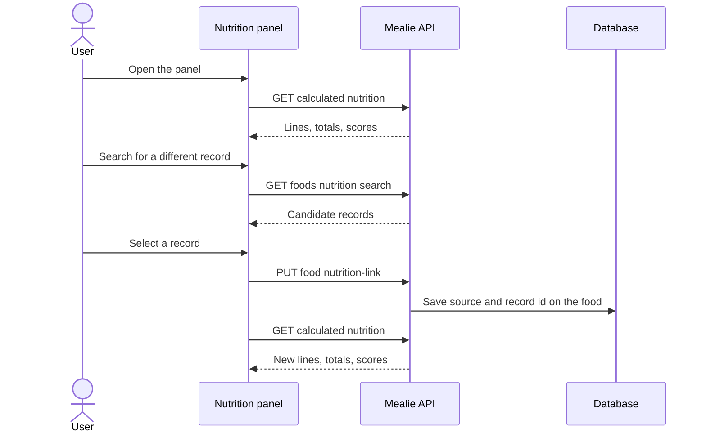

# Food Nutrition Design

This page describes how Mealie calculates the nutrition of a recipe from its ingredients.
Each section gives the design and the reason for it.

## Goal

Mealie calculates calories, macronutrients and micronutrients for a recipe from the parsed ingredients.
The result shows one row for each ingredient, so a user can find the source of each number.
The saved nutrition on a recipe stays as it is, because the user or the source website supplied it.
A language model does not estimate the values, because the estimate is not accurate enough and the user cannot examine it.

## Data Flow

Each ingredient line goes through the same four steps.
The service calculates the result at request time and does not store it.
A change to a recipe, a unit or a food link thus shows in the next request.
This design needs no cache and no job to keep stored values correct.

## Code Layout

All logic is in `mealie/services/nutrition/`.
Only `nutrition_service.py` imports Mealie schemas.
The other modules use plain data classes, so unit tests run without a database.
`nutrients.py` defines the 29 nutrient keys, for example `energy_kcal` and `sodium_mg`.
Mealie owns these keys, so a second food database can map to them later.

## Bundled Food Data

Mealie ships the food data in the repository and does not call an external API.
An installation thus needs no API key and no network connection, and a search sends no data to a third party.
The USDA files are in the public domain.
The build script keeps only the 29 nutrients and the household portions, which gives a file of 0.8 MB.
The script removes each record that has no energy value, because such a record adds zero calories to a total.
The Open Tandoor Data list uses the Open Database License, and the maintainers must accept that license before a release.

## Food Link

A food link connects one Mealie food to one database record.
The choice of the user has priority, because only the user knows which variety the recipe means.
The curated list is next, because a person already selected the variety of each common food.
The ranked search uses the USDA name structure, in which the food word comes first, as in `Onions, raw`.
A weak match shows in the result but does not add to the total, because many weak matches point to a different food.
`REWRITES` and `DEFAULT_VARIETY` in `matching.py` change kitchen words to database words, and they contain English words only.

## Weight in Grams

Nutrient values are for 100 g, so each line needs a weight.
A weight unit converts directly with the standard unit that Mealie stores on each unit.
A volume unit or a count needs a household portion of the food, for example `1 cup, chopped = 160 g`.
The design has no density field, because a volume portion gives the same data for all volume units.
The words of the ingredient note select the portion, so `chopped` selects a different weight than `sliced`.
A line without a correct portion gets a status and adds nothing, because an estimated weight gives an incorrect total without a sign.

## Recipe Total and Line Status

| Status | Meaning | In the total |
|---|---|---|
| `ok` | Food link and weight found | Yes |
| `weak_match` | The link is not reliable | No |
| `no_quantity` | The line has no quantity, for example salt to taste | No |
| `no_food` | The line has no parsed food | No |
| `no_link` | No database record found | No |
| `no_volume_weight`, `no_count_weight`, `no_unit_weight` | No portion for the unit | No |

The total is the sum of the `ok` lines, and the value for each serving divides it by `recipe_servings`.
A recipe without a serving count shows the recipe total only.
The response gives the number of counted lines and the number of lines that a full calculation counts.
The user thus sees how much of the recipe the numbers include.

## Scores

Mealie shows two scores, because they measure different properties.
The Nutri-Score algorithm has the strongest evidence from health outcome studies, but it does not use micronutrients.
NRF 9.3 uses nine nutrients to encourage and three nutrients to limit, so it shows the micronutrient density.
`scoring.py` implements the 2023 Nutri-Score rules for general foods, and its point tables agree with the Open Food Facts implementation.
NRF 9.3 uses the current FDA Daily Values and total sugar, because the USDA files do not give added sugar.
The Nutri-Score result uses the raw ingredient weight, and `food_groups.py` estimates the fruit, vegetable and legume share from the USDA food category.

## Database Change

The migration adds two nullable string columns to `ingredient_foods`.
Mealie stores the link on the food, so one correction applies to each recipe that uses the food.
Both columns are strings, so a food database with text identifiers can use them later.
`AutoInitOptions` excludes the columns, so an ordinary food update cannot remove the link.
Mealie stores no nutrient values, because the bundled data supplies them from the record identifier.

## API

| Method and path | Access | Function |
|---|---|---|
| `GET /api/recipes/{slug}/nutrition/calculated` | Signed-in user | Result for one recipe |
| `GET /api/explore/groups/{group_slug}/recipes/{recipe_slug}/nutrition/calculated` | Public | Same result, for a publicly visible recipe |
| `GET /api/foods/nutrition/search?q=` | Signed-in user | Search the bundled food data |
| `PUT /api/foods/{item_id}/nutrition-link` | `GROUP_ORGANIZE` permission | Set or clear the record of a food |

The public route calls the same visibility check as the public recipe route, so it shows no recipe that is private.
A separate route sets the food link, so a client cannot change it by accident in a food update.
The search accepts a word that the user did not complete, and the word order has no effect.

## Frontend

`RecipeNutritionCalculated.vue` adds a button to the recipe page and opens a dialog.
The dialog shows the two scores, a comparison with the saved nutrition, and one row for each ingredient.
A row opens to show the other candidate records, all nutrients of the line, and the controls to select a different record.
The controls show only for a signed-in member of the group, and a visitor gets the same data without them.
The control for the amount basis is adjacent to the ingredient table, because it changes only that table.

## Limits

- The link is for each food and not for each ingredient line, so one food cannot be cooked in one recipe and dry in a different recipe.
- The calculator does not read a weight from the ingredient note, so a line such as `1 can, 14 oz` gets `no_unit_weight`.
- The word tables and the search use English names, so a food with a name in a different language needs a manual link.
- A missing nutrient value counts as zero, so the totals for vitamins D, E and K are minimum values.
- The Nutri-Score result does not apply the special rules for beverages, fats, cheese and red meat.
- An automatic `curated` or `search` link counts in the total before the user confirms it.

## Tests

`tests/unit_tests/services_tests/nutrition/` contains unit tests for the two scores, the text search and the manual link.
`dev/scripts/nutrition_report.py` runs the calculation on a development database and writes one file for each of links, ingredient lines and recipes.
The report compares the calculated values with the saved nutrition, which shows the effect of a change to the match rules.
